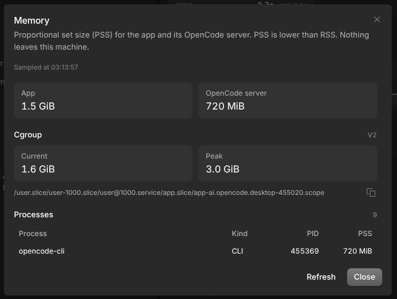

# @kyan-plugins/memory-monitor

App and OpenCode server memory in the OpenCode Desktop titlebar, with a per-process breakdown on click. Linux only.



## What it shows

The titlebar shows a server icon at rest. On hover it reads `1.4G · 720M`: app PSS first, then the OpenCode server, or
`off` when the sidecar is not running. Click it for the totals, the sample time, cgroup current and peak usage, and a
per-process breakdown sorted by PSS. The process list scrolls in a fixed-height region with a sticky header and a
process count. The dialog samples fresh when it opens and has a Refresh action. If a sample fails,
the hover text says so and a click retries; an open dialog shows the error with its own Retry action.

## Install

```bash
opencode plugin add @kyan-plugins/memory-monitor
```

Requires OpenCode Desktop 2.2.0 or newer and Linux. **Settings > Extensions > Plugins** lists it after it loads. Other
systems show it as not available.

## Where the numbers come from

- **App tree:** starts at the Electron main process (`process.pid`), walks `/proc/<pid>/stat` parent relationships, and
  sums `Pss` from `/proc/<pid>/smaps_rollup` for the main process and its descendants. Crashpad handlers and other
  reparented helpers are added when their `--database` or `--user-data-dir` matches the app, so losing their parent does
  not lose their memory.
- **OpenCode server:** reads `~/.local/state/opencode/service.json` and uses its pid only after checking that the process
  is alive, that its cmdline is the managed `opencode-cli ... serve --service`, and that its URL matches the sidecar
  endpoint the app reports. A stale or recycled pid, a plain development `opencode serve`, or an endpoint that cannot be
  matched reports the server as not running. The sidecar and its descendants are left out of the app tree, and the
  server total includes those descendants (language servers and tool children), so no pid counts in both totals.
- **Cgroup:** reads the app's own cgroup from `/proc/self/cgroup`. On cgroup v2 it reads `memory.current` and
  `memory.peak`; on cgroup v1 it reads `memory.usage_in_bytes` and `memory.max_usage_in_bytes`. Missing files or an
  unreadable cgroup show as unavailable rather than failing the sample.
- **PSS:** proportional set size counts a shared page once across the processes that map it. It is lower than RSS, which
  counts that page in every process.

The titlebar samples every 45 seconds, and only while its window is visible and focused. It refreshes on focus and stops
its timer when the window blurs or hides. The dialog samples once on open and then only when you press Refresh.

Processes can exit while a sample runs. Unreadable or vanished entries are skipped, so one exit does not fail the whole
sample.

Reads are local `/proc` and cgroup files, plus `~/.local/state/opencode/service.json` to locate the managed server.
Nothing leaves the machine and no data is stored.

## Compatibility

The GUI plugin API is experimental, and this package is built against `@opencode/plugin` 2.2.0. A future desktop release
can change that API, so check the release notes before assuming a newer app works.

## Development

```bash
bun install
bun run dev     # rebuilds dist/gui-experimental.cjs on change
```

To test a local checkout, point the global config at it instead of the package name:

```jsonc
// ~/.config/opencode/opencode.jsonc
{
  "plugins": ["/path/to/opencode-plugins/packages/memory-monitor"]
}
```

The app reloads the bundle in every window after each rebuild.

## License

MIT
